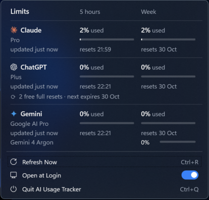

# AI Usage Tracker

A small Windows 11 tray app, in the spirit of RunCat and [limitbar](https://github.com/dancik/limitbar), that shows how much of your **Claude Pro**, **ChatGPT Plus** and **Google AI Pro** limits you have used.



- **Taskbar:** three small number icons, one per AI, each showing that AI's highest current usage (5-hour or weekly window).
  - Digits are **white** below 80 %, **amber** from 80 % and **red** from 90 %.
  - The colored underline tells them apart: orange = Claude, green = ChatGPT, blue = Gemini.
  - Hovering shows `Claude 36% · ChatGPT 13% · Gemini 0%`.
- **Click (left or right) any icon:** a translucent panel with every limit, its bar, and when it resets. Starting the app again from the Start Menu also opens the panel.
- **Footer:** Refresh Now · Open at Login · Quit.
- **Keys:** Esc closes the panel; Ctrl+R refreshes; Ctrl+Q quits.

## Install

1. Run `dist\AIUsageTracker-Setup-1.0.0.exe`. It installs for your user only, with no admin prompt, to `%LOCALAPPDATA%\Programs\AI Usage Tracker`.
   The installer is not code-signed, so SmartScreen may warn: click **More info › Run anyway**.
2. Windows hides new tray icons at first. Open **Settings › Personalization › Taskbar › Other system tray icons** and turn on the three *AI Usage Tracker* entries, or drag them out of the `^` overflow onto the taskbar.

Uninstall from **Settings › Apps › Installed apps › AI Usage Tracker**. This removes the app, the shortcut, the startup entry and the settings.

## Where the numbers come from

Like limitbar, the app **asks each AI's own command-line tool** for its usage. It never reads a token, cookie or password, and it makes no network calls of its own. None of these calls uses a model, so they cost nothing. It refreshes every 10 minutes, and whenever you click *Refresh Now*.

| Card | Command | What it measures |
|---|---|---|
| Claude | `claude -p /usage` (Claude Code) | Your Claude plan's 5-hour session and weekly limits. These are shared by claude.ai and Claude Code. |
| ChatGPT | `codex app-server` → `account/rateLimits/read` (Codex CLI) | Your ChatGPT plan's **Codex** 5-hour and weekly limits, plus any free full resets. No tool exposes the chat-message caps. |
| Gemini | `agy -p /quota` (Google Antigravity CLI) | Your Google AI Pro **Antigravity** quota (Gemini models: 5-hour and weekly), plus Gemini 4 Argon. It does not cover the Gemini app's chat limits. |

All three CLIs must be installed and signed in. On this PC they live in WSL (distro `Ubuntu-20.04`), so the app runs them through `wsl.exe`.

- If a card says **"Not signed in — run `…`"**, open that CLI in WSL and sign in.
- **"No data"** means the CLI is missing, timed out, or changed its output. The last good numbers stay visible, dimmed.

## Settings

`%LOCALAPPDATA%\AIUsageTracker\config.json` is created on first run:

```json
{ "wslDistro": "Ubuntu-20.04", "refreshMinutes": 10 }
```

Set `wslDistro` to `""` if the CLIs are installed natively on Windows. Quit and restart the app after editing.

## Build from source

You need the [.NET 10 SDK](https://dotnet.microsoft.com/download) and Inno Setup 6 (`winget install --id JRSoftware.InnoSetup -e --scope user`). Then:

```powershell
.\build.ps1 -Version 1.0.0     # tests → dotnet publish → dist\AIUsageTracker-Setup-1.0.0.exe
```

The parser tests also run on Linux/WSL: `dotnet test tests`.

| File | What it does |
|---|---|
| `src/Usage.cs` | Runs the CLIs and parses their answers into cards (the only logic with tests) |
| `src/App.cs` | Entry point: tray icons, refresh timer, config, Open at Login |
| `src/Flyout.xaml(.cs)` | The detail panel (Windows 11 acrylic, dark) |
| `src/Marks.cs` | Brand marks ([simple-icons](https://github.com/simple-icons/simple-icons), CC0) |
| `tests/ParseTests.cs` | Parser tests on real, redacted CLI output |
| `installer/setup.iss` | Inno Setup script |

The marks are trademarks of their owners and only identify each service. This project is not affiliated with Anthropic, OpenAI or Google.
